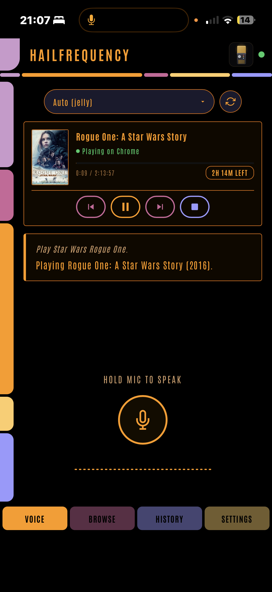
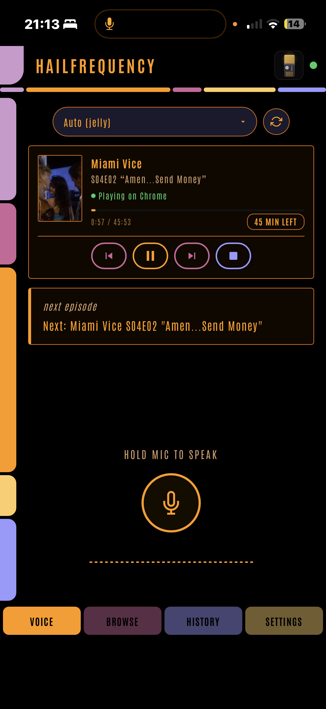
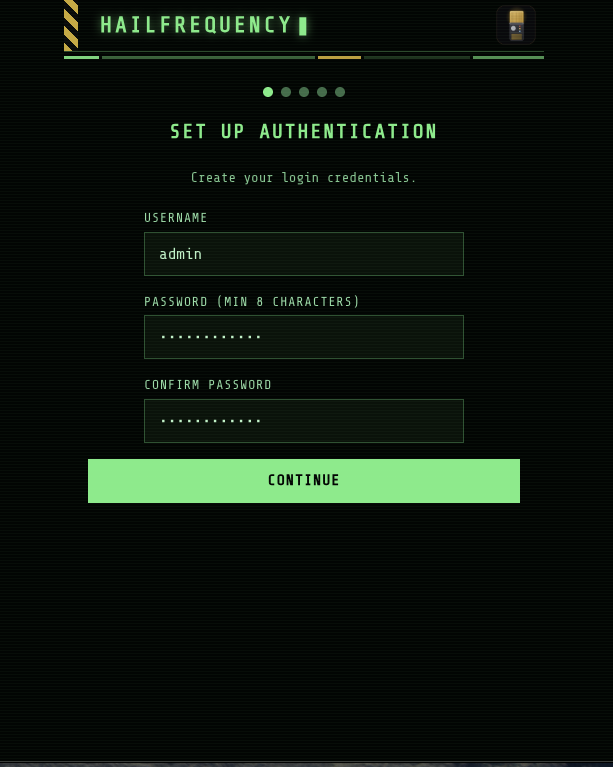

# HailFrequency

Voice control for Emby and Jellyfin. Hold a button on your phone, say what you want to watch and where, and it starts playing.

<p>

&nbsp;

</p>

I built this because I wanted a Star Trek computer for my media server. Something I could pick up, say play The Expanse season two episode four on the Shield, and have it happen. No wake word, no microphone that's always listening, no cloud account. It runs as one container next to your media server, and as long as the speech and AI containers it talks to are on your own hardware, nothing leaves the house.

It's an early release. So far it's been used by one person, me, with one Emby server, one Jellyfin server, an iPhone, an Android tablet and a handful of playback devices. I'd like it to become a community project, and the section near the end says what kind of help is most useful. If you try it and it mishears or misunderstands you, that's exactly the feedback I need.

## Contents

- [What it does](#what-it-does)
- [What you need](#what-you-need)
- [Installing on Unraid](#installing-on-unraid)
- [First run](#first-run)
- [Using it](#using-it)
- [Installing on other Docker hosts](#installing-on-other-docker-hosts)
- [How it understands you](#how-it-understands-you)
- [When something doesn't work](#when-something-doesnt-work)
- [Security and what it stores](#security-and-what-it-stores)
- [Help make it better](#help-make-it-better)
- [Why not Plex](#why-not-plex)
- [Building from source](#building-from-source)
- [Licence](#licence)

## What it does

Everything here works on Emby and on Jellyfin. The device on the receiving end has to be one your media server lists as remote controllable, with its Emby or Jellyfin app open, because HailFrequency can't turn a TV on. I've tested against the official Emby and Jellyfin apps on an Nvidia Shield and in a browser, and both honour every command below. Some third party ones advertise a command and then quietly ignore it, and the community section asks you to report those.

Commands marked with an asterisk need Ollama. Everything else works without it, as long as you phrase it roughly the way it's written here or in the in app cheat sheet. Paraphrasing freely is what Ollama is for.

Playing things. "Play The Matrix". "Play the next episode of Frasier". "Play Voyager season 3 episode 4". "Play season 2 of The Wire". "Play my James Bond collection". "Play the chill playlist shuffled". "Play Bosch on the Shield"\*.

Random and shuffle. "Play a random movie". "Shuffle Star Trek Enterprise". "Shuffle unwatched episodes of Frasier". "Play an 80s action film"\*. "Play a good sci-fi movie I haven't seen"\*. "Put something funny on in the lounge"\*.

Transport. "Pause". "Resume". "Stop". "Next episode". "Skip forward five minutes". "Rewind". "Start from the beginning". "Jump to 1:20:00".

Volume. "Volume up". "Turn it down". "Set the volume to 40". "Mute".

Subtitles. "Turn on subtitles". "French subtitles on". "Subtitles off". When you don't name a language it picks the one your media server profile prefers, then the track flagged default, and a plain subtitles on never picks a forced track.

Audio track. "Switch the audio to English". "Play it in Japanese". It picks the plain track in that language, skipping audio description and commentary, and if the file doesn't have that language it tells you which ones it does have.

Library questions. "What's playing?". "What's new?". "Latest sci-fi shows". "How much longer?". "Mark this as watched". "Search for Blade Runner". "Show me movies with Tom Hanks"\*. Answers appear as text on your phone, and are read out if you've set up spoken replies.

Sleep timers. "Stop playing in 30 minutes". "Sleep timer for an hour". "Cancel the sleep timer". Timers are per device, so a bedroom timer doesn't stop the lounge. They live in the container, so restarting it cancels them.

Misheard titles. Speech recognition sometimes spells a title differently from your library, Cary for Carrie, say. When your server's own search then finds nothing, HailFrequency matches what you said against your library's titles by spelling and by sound. A clear winner plays. A close call shows you cards to pick from. Nothing plausible stays an honest not found rather than a guess.

Asking when it's not sure. If a series has several seasons and you didn't say which, or a search matches more than one thing, or two devices are playing and you didn't name one, you get cards on screen to tap rather than it picking for you.

More than one person. Everyone signs in with their own Emby or Jellyfin account and their commands run as them, so watch state and Continue Watching stay personal. New sign ins are disabled until an admin enables them. There's no setting to make that permissive.

Spoken replies. Optional. With a text to speech server set up, the result is read out by the phone, not the TV. Volume and mute stay silent because you can already hear those worked.

Browse tab. For when you'd rather tap than talk. Continue Watching, Next Up, Recently Added, genre chips, typed search and a strip of what's currently playing. Taps confirm before they play.

Nine themes. LCARS is the default. Theme is per user.

Say "what can I say" and it shows you a cheat sheet in the app.

## What you need

A media server. Emby or Jellyfin, with an API key. I've tested it on Emby 4.11 and Jellyfin 12.1. Older versions will probably work, and if you run one and it does or doesn't, tell me. It won't work with Plex, and there's a section at the end on why.

Speech to text. HailFrequency posts your recording to a Whisper server that uses the standard /v1/audio/transcriptions endpoint, and lists models from /v1/models. I use [Speaches](https://github.com/speaches-ai/speaches), which is in Community Apps, and that's what's tested. It runs Whisper models. A CPU copes with the small models, a GPU makes the large ones usable, and the large ones hear titles much better. None of the three services, Speaches, Ollama or TTS, can be given an API key or a password from HailFrequency, so they need to accept plain requests from your LAN.

Optionally, Ollama. Without it, every command above without an asterisk works. With it you get conversational phrasing and naming a device inside the command. Ollama is in Community Apps. It works on a CPU, but a new phrase can then take anywhere from ten seconds to a few minutes to parse, which is what the setup wizard's skip button is warning you about. On a GPU it's a few seconds. Either way a phrase only has to be parsed once. Say the same words again and it's replayed without the model.

Optionally, text to speech. Any server with the standard /v1/audio/speech endpoint. If the server offers a voice list at /v1/voices you get a dropdown, and if not, Speaches included, you type the voice name. For Kokoro that's names like af_heart. Speaches does TTS as well, so one container can cover both jobs.

HTTPS to reach it from a phone. Here's the bit that catches people out. Browsers only let a page use the microphone when it's loaded over HTTPS, or from localhost. So open HailFrequency at http://192.168.1.50:8069 on your phone and you'll get a working app with a dead mic button. The answer is Tailscale. On Unraid it's the Use Tailscale switch on a container's template, which is built into Unraid 7's Docker manager, and on any other Docker host it's a Tailscale sidecar container, both covered below. Either way the container gets its own https address with a proper certificate, nothing is forwarded and nothing is exposed to the internet. I'd steer clear of a reverse proxy for this one. It holds your media server's admin key, and Tailscale keeps it reachable only from phones you've signed in, with HTTPS done for you. The catch is that every phone that'll use it needs the Tailscale app installed, signed in to the same tailnet and connected. Tailnet is Tailscale's word for your private network of devices. The TV doesn't need Tailscale, only its Emby or Jellyfin app open.

None of this needs a GPU. One makes the bigger Whisper models and Ollama a lot quicker, that's all.

## Installing on Unraid

This is written for someone who's already got Emby or Jellyfin running on Unraid and has installed containers from Community Apps before. You need Unraid 7 or newer for the Tailscale part.

Before HailFrequency, get these in place. The ones on your phone and media server are easy to forget and awkward to do mid wizard.

A Tailscale account, which is free for personal use, at tailscale.com. You don't need the Tailscale plugin from Community Apps for this. That plugin puts Tailscale on Unraid itself, which is a separate thing. Unraid 7's Docker manager has its own built in Tailscale support that puts Tailscale inside the HailFrequency container, and that's what we use. Then in the Tailscale admin console on the web, at login.tailscale.com, open the DNS page and turn on MagicDNS and HTTPS Certificates. Both are one off switches for your whole tailnet. Without HTTPS Certificates the Serve option below shows an Enable HTTPS warning and won't work. While you're on that page, note your tailnet name, the something.ts.net part, you'll need it for the address.

The Tailscale app on each phone that'll use HailFrequency, signed in to the same tailnet.

An API key from your media server, copied somewhere you can paste from your phone. On Emby, click the cog at the top right to reach the dashboard, then API Keys at the bottom of the left hand menu. On Jellyfin, click your user icon at the top right, then Dashboard, then API Keys at the bottom of the left hand menu. Name it HailFrequency so you know what it's for later. Bear in mind an Emby or Jellyfin API key has full admin rights on that server, which is part of why the security section matters.

Speaches, from Community Apps. The template installs the CPU image, which is fine for the small Whisper model. If you have an Nvidia card and the Nvidia Driver plugin, change the Repository to ghcr.io/speaches-ai/speaches:latest-cuda and add --runtime=nvidia --gpus=all to Extra Parameters (switch on the advanced view to see it). Once it's running, open its WebUI from the Docker tab and download a Whisper model by its full name. Systran/faster-whisper-small is what I run and a sensible start. On a GPU, Systran/faster-whisper-large-v3 hears titles better. HailFrequency can only pick from models Speaches has already downloaded. If you want spoken replies, download speaches-ai/Kokoro-82M-v1.0-ONNX there too while you're at it. Note the host port shown next to Speaches on the Docker tab, 8000 unless you changed it.

Ollama, from Community Apps, if you're having it. Without a GPU I'd skip it for now and add it from Settings later if you miss it. Pull a model before you start, by opening the Ollama container's console from the Docker tab and running a pull command like the one below. The model has two jobs. One is turning a sentence into one of about twenty actions, which most instruction tuned models of 7 billion parameters and up manage. The other is recognising a film from a description, which gets better the bigger the model is, with no real ceiling. So pick by the memory on your card. Around 8 GB, try a 7 or 8 billion parameter model. Around 12 to 16 GB, a 12 to 14 billion one. With 24 GB or more you can run the 27 to 32 billion models, which is what I do. Stick to the current Qwen, Gemma or Llama instruct models rather than anything exotic, skip the 1 to 3 billion ones, which answer fast and wrong, and if a command gets misread, try the next size up before anything else. The Settings page tells you whether Ollama is running the model on the GPU. If the Engine line says CPU, the first command after a quiet spell will be slow, and that's the thing to fix before changing models.

```
ollama pull qwen2.5:14b
```

If you'll be controlling a Shield or other TV, turn it on and open the Emby or Jellyfin app so it's visible when the wizard asks about devices.

Now HailFrequency.

1. Open Community Apps, search for HailFrequency and click Install
2. Leave the Web Interface port at 8069 unless something else on your server is using it
3. Leave App Data at /mnt/user/appdata/hailfrequency. Give it its own folder, don't point it at another container's
4. Turn on Use Tailscale. A Tailscale section appears
5. Set Tailscale Hostname to whatever you want the address to start with. I use hail, so with a tailnet called my-tailnet.ts.net the address becomes https://hail.my-tailnet.ts.net
6. Set Tailscale Serve to Serve. Not Funnel. Funnel publishes it to the whole internet and you don't want that
7. Tailscale Serve Port should fill itself in as 8069. If it's blank, type 8069. It's the container's own port, so it stays 8069 even if you changed the host port in step 2
8. Leave every other Tailscale field alone and click Apply

The first start takes a minute or so longer than usual, because Unraid downloads Tailscale into the container. Open the container log, since the first time it prints a login link to register the container with your tailnet. Follow it, sign in, and it shows up as a new machine with that hostname on the Machines page of the admin console, which is expected. The login is kept in the appdata folder, so updates and recreates don't ask again. The container log prints the https address once Serve is running, followed by the application startup lines. By default Tailscale machine keys expire after six months, and when that happens the https address stops working until you re-authenticate. The container's log tells you about this. I'd go to the Machines page, open the menu next to it and click Disable key expiry, then it's done for good.

Once it's up, the container's icon on the Docker tab has a Tailscale WebUI entry that opens the https address. It only opens from a computer that's on your tailnet too. Either way, type that address into the browser on your phone, that's the one to use from now on. The plain http://your-server:8069 address still works for everything except the microphone, and logging in on one address doesn't log you in on the other.

Leave the advanced variables alone unless you've got a reason. Data Directory has to match the container side of the App Data mapping and the template already does that. Admin Password Reset is for when you've locked yourself out, and the description on it says what to do.

## First run

Open the https address and you get a five step wizard. Nothing else works until it's finished. Do it straight away, because until you've set the admin password in step one, the setup pages are open to anyone who can reach the address. After step one they only answer to you, and once the wizard's finished they close completely.



Set Up Authentication. Pick a username and a password of at least eight characters. This is a local account that lives only in HailFrequency, and it's your way back in if anything goes wrong, so it can't be deleted from inside the app. I'd give it a name that isn't also one of your Emby or Jellyfin usernames, to keep the two kinds of sign in obviously apart.

Connect Speaches. The Speaches URL is the address of your Speaches container as seen from the HailFrequency container, so your server's LAN IP and the Speaches host port, like http://192.168.1.50:8000. Base address only, no /v1 on the end, and not localhost, which would mean the HailFrequency container itself. Click Test Connection, then pick the model you downloaded from the STT Model list.

Connect Ollama. Same again with the Ollama URL, the LAN IP and Ollama's host port, 11434 unless you changed it, Test Connection, and pick a Model. Or click Skip, I don't have a GPU, and carry on. You can add it later from Settings without redoing any of this.

Add Media Server. A Server Name of your choosing, the Server Type, the Server URL in the same form as before, say http://192.168.1.50:8096, or the https address if your server has one, and the API Key you made earlier. Test Connection, then choose a User Account. Pick your own. The key itself has admin rights, and the account you choose only decides whose watch state and Continue Watching the admin's commands run against. You can add more servers afterwards in Settings.

This step also offers to give your playback devices spoken names, the Shield or bedroom rather than whatever the device calls itself. The name is what Ollama matches when you say a device in a command. Without Ollama the dropdown still shows the device's own name and the alias isn't used. Only devices with the Emby or Jellyfin app open right now appear in the list, so if the TV's off, skip it. It's in Settings under Device Aliases whenever you want it.

Setup Complete. Click Open HailFrequency and you're on the Voice tab.

The wizard doesn't ask about spoken replies. If you want them, go to Settings, Voice Response (TTS), turn on Enable voice responses, put in the TTS Service URL, pick the Kokoro model and type a voice name, af_heart to start with. If Speaches is doing your TTS, that URL is the same one you gave it in step two.

## Using it

Hold the big button, speak, let go. The transcript shows up, then the result, then the now playing card updates a second or so later.

Pick the device from the dropdown under the button, or say it in the command if you've got Ollama. If you don't pick one and don't say one, it goes to the one device that's playing, or the one device that has the app open if nothing's playing. With several open and nothing playing, or several playing, it asks which. With none open it tells you to open Emby or Jellyfin on a device first.

The first time you use a phrase that needed Ollama, it takes however long your model takes, and you'll see a Thinking indicator. The second time it's instant, because a parse that ran successfully is remembered and the same transcript, ignoring case and punctuation, is replayed without the model. A remembered phrase that later fails to run, say because the TV was off, is forgotten and goes back to the model next time. The History tab shows which route every command took, marked FAST, LEARNED, AI or SEARCH, so it's never a mystery why something was quick or slow. You see your own history. Admins see everyone's.

I'd add it to your phone's home screen. In Safari that's Share then Add to Home Screen. In Chrome on Android it's the three dot menu then Add to Home screen, or Install app on newer versions, and Chrome may offer this in a banner at the bottom of the page on its own. It then opens full screen like a normal app, and the microphone works from there. I use it from an iPhone this way and it's been tried on an Android tablet in Chrome. Other Android browsers haven't been tried, and whether they behave is the kind of thing I'd like to hear about.

Other people in the house sign in with their own Emby or Jellyfin username and password. Their first sign in creates a disabled account and shows them a message saying it's waiting for approval. You enable them in Settings, under Users. Sign ins last 30 days from the login. Disabling an account signs that person out of HailFrequency straight away, though the token it holds on your media server stays in that server's device list until you remove it there.

## Installing on other Docker hosts

The container's the same anywhere. What Unraid's Tailscale switch does for you, a Tailscale sidecar does on any Docker host: a second small container that joins your tailnet, gets the https certificate and hands requests to HailFrequency over a shared network namespace. This is the arrangement I'd use, and it behaves exactly like the Unraid install, so everything else in this README applies. A reverse proxy also works, but then HTTPS, the certificate and HF_TRUSTED_PROXIES are yours to get right, and the app holds your media server's admin key, so I wouldn't.

You need an auth key from the Keys page of the Tailscale admin console. Make it reusable if you'll recreate the container, and tagged or not as you prefer. Then two files side by side, both in this repository as docker-compose.yml and serve.json, so copy those rather than typing. First, the serve configuration, which tells the sidecar to answer on 443 and pass everything to port 8069 inside the shared namespace:

```json
{
  "TCP": { "443": { "HTTPS": true } },
  "Web": {
    "${TS_CERT_DOMAIN}:443": {
      "Handlers": { "/": { "Proxy": "http://127.0.0.1:8069" } }
    }
  },
  "AllowFunnel": { "${TS_CERT_DOMAIN}:443": false }
}
```

The TS_CERT_DOMAIN placeholder is filled in by the sidecar with the machine's own tailnet name, so leave it as written. The AllowFunnel false line keeps it off the public internet, which is the point. Then the compose file:

```yaml
services:
  tailscale:
    image: tailscale/tailscale:latest
    container_name: hailfrequency-ts
    hostname: hail
    environment:
      - TS_AUTHKEY=tskey-auth-<your key>
      - TS_STATE_DIR=/var/lib/tailscale
      - TS_SERVE_CONFIG=/config/serve.json
      - TS_USERSPACE=false
    volumes:
      - ./tailscale:/var/lib/tailscale
      - ./serve.json:/config/serve.json:ro
    devices:
      - /dev/net/tun:/dev/net/tun
    cap_add:
      - net_admin
    restart: unless-stopped

  hailfrequency:
    image: ghcr.io/spaceinvaderone/hailfrequency:latest
    container_name: hailfrequency
    network_mode: service:tailscale
    depends_on:
      - tailscale
    volumes:
      - ./config:/app/config
    environment:
      - PUID=1000
      - PGID=1000
    restart: unless-stopped
```

The hostname line is the name the machine gets on your tailnet, so https://hail.your-tailnet.ts.net is the address. There's no ports block on purpose. HailFrequency shares the sidecar's network, so the only way in is the https address, and plain http on your LAN doesn't exist. Put your auth key in, set PUID and PGID to your own ids, bring it up with docker compose up -d, and the sidecar's log shows the machine joining and the certificate being fetched, which takes a minute the first time. docker exec hailfrequency-ts tailscale serve status prints the https address, marked tailnet only, and that's the one to open on the phone. Once the key has done its job you can remove the TS_AUTHKEY line, since the state folder keeps the login. As on Unraid, I'd disable key expiry for the machine in the admin console. HF_TRUSTED_PROXIES stays unset: the sidecar isn't a proxy in that sense and the app sees each phone's own tailnet address, which is what the login throttle and the sign in cookie need.

The app always listens on 8069 inside the container. Without HF_DATA_DIR set, the data lives at /app/config inside the container. It starts as root, sets the data folder's owner to PUID:PGID with owner only permissions, then drops to that user. A user: line in the compose file stops it doing that and it won't start, so set PUID and PGID instead. The defaults are Unraid's, and on another host you'll want your own ids, from id -u and id -g, so you can read and back up the folder. The image has a Docker health check, so docker ps shows healthy, and the same endpoint is at /api/health for your own monitoring. It needs no login and returns the status, version and build date.

These are all the environment variables there are. Everything else is set in the web interface.

| Variable | Default | What it's for |
|---|---|---|
| HF_DATA_DIR | /app/config | Where the database lives inside the container. The Unraid template sets this to /data. |
| PUID | 99 | The user the process runs as, and the owner of the data folder. |
| PGID | 100 | The group, likewise. |
| HF_TRUSTED_PROXIES | unset | Only if you've put a reverse proxy in front against the advice above. See below. |
| HF_ADMIN_RESET_PASSWORD | unset | Recovery only. See below. |

HF_TRUSTED_PROXIES. With Tailscale, either way, leave it unset. If you've put a reverse proxy in front regardless, set it to the exact address the container sees the proxy's connections coming from, which the container log prints on every request. Without it, behind a proxy, the login throttle sees every visitor as one address, so one person's five typos lock everyone out for 30 seconds, and the sign in cookie isn't marked secure because the app thinks you arrived over plain http. Neither problem exists with Tailscale, which is one of the reasons to use it.

HF_ADMIN_RESET_PASSWORD. Set it to a new password of eight or more characters and restart. On that start the local admin's password becomes that value, the username stays as it was, and everyone is signed out. It does this on every start while the variable is set, so remove it and restart again once you're back in, then change the password from inside the app, since it sat in plain text in your compose file or template meanwhile.

Then carry on from First run above, using that https address.

## How it understands you

Every command goes down the same four rungs, in order, and stops at the first one that answers.

First, a pattern matcher. A list of exact phrases and templates like play X season N episode M, matched against the lower cased transcript. This is instant and it goes first even when Ollama is running, because it's faster and more predictable than any model.

Second, remembered phrases. Anything Ollama has parsed before, that then ran successfully, is stored, and an exact repeat is replayed without asking the model again. A phrase that later fails is forgotten, so it goes back to the model next time. Remembered phrases are shared by everyone on the install, and Settings has a Voice Learning section where you can see, delete or clear them.

Third, Ollama. Anything new goes to your model along with a description of the commands it can produce and the names of your servers and devices, and comes back as a structured command. The app checks whether the model is on GPU or CPU and waits 30 seconds or 4 minutes accordingly.

Fourth, a plain title search, which is only reachable when Ollama is skipped, unreachable or doesn't answer within the wait. A phrase shaped like play X becomes a search for X in your library. Anything else fails with a message saying the AI parser isn't available, rather than searching your library for whatever words you said.

If Ollama is running and says it doesn't understand you, that's the answer. The search rung doesn't get a second go, because it's there for when there's no model, not for second guessing one.

Everything the model returns is checked against a schema before anything is sent to your media server. An unknown action, a missing field or a value out of range is rejected, not executed.

What this means in practice, especially on a CPU. The first rung is why the everyday commands never wait: pause, resume, next episode, volume, subtitles, play a named title, play a series by season and episode number, shuffle a series, sleep timers and the library questions are all patterns, so they're instant whether Ollama is there or not, and whether it's on a GPU or not. The History tab marks these FAST. Ollama is only consulted for phrasing the patterns don't cover, and on a CPU that's the wait the wizard warns about, ten seconds to a few minutes for a new phrase. But you pay it once. A phrase Ollama parsed and that then ran is remembered, and saying the same words again, with case and punctuation ignored, replays it at once, marked LEARNED. So on a CPU the app gets faster the more you use it, and the way to keep it quick is to settle on phrasings you like and reuse them. The in app cheat sheet, say "what can I say", lists the pattern forms. Remembered phrases are shared by everyone on the install, the most recent five hundred are kept, and the Voice Learning section in Settings shows them and lets you delete any that have gone wrong.

## When something doesn't work

The mic button does nothing, or the browser asks for microphone permission and then nothing happens. You're on plain http, or on an https address whose certificate the phone doesn't trust. Use the Tailscale https address.

Play works but the video sits on a spinner, or at 0:00 paused. That's the browser based players. Chrome won't autoplay with sound in a tab you haven't clicked in, so a command to Emby Web or Jellyfin Web in a fresh tab loads the video and waits for a click. Click once in that tab and it goes. TV and phone apps don't have this problem.

The first command takes ages, then they're fine. Your Ollama model had been unloaded and had to be read back into memory. In Settings, Ollama (LLM), turn on Idle timeout and choose Always to keep the model loaded between commands.

A device is missing from the list. Only devices your media server can currently see, and reports as remote controllable, show up. Open the Emby or Jellyfin app on that device so it registers a session, then use Re-discover Users & Devices in Settings.

The https address stopped working after months. The container's Tailscale key expired. Disable key expiry for it in the Tailscale admin console, as described in the install section.

It heard me but did the wrong thing. Go to the History tab, find the command, and send me the transcript and what you actually meant. That's the single most useful thing you can contribute.

## Security and what it stores

This app holds your media server's API key and acts with it, so treat its address like your router's admin page.

Keep it on your tailnet. Don't port forward it, don't put it behind an internet reachable reverse proxy, don't turn on Tailscale Funnel. There's no setting that makes any of those a good idea. Tailscale means only phones signed in to your tailnet can reach it at all, before the app's own login even comes into it.

What's in the data folder is one SQLite database. It holds the API key for each media server in plain text, a login token for each person on each server once they've signed in, the local admin's password hash, your settings, the last thousand commands with their transcripts, and the remembered phrases. The container log also carries every transcript, so treat it the same way. Library titles used for misheard title matching never leave the container. The container sets the folder to owner only on every start. On Unraid that owner is uid 99, which is the same account most containers run as, so the real protection is that the folder isn't mounted into anything else. Don't share it.

Sign in cookies are signed with a random key, marked HttpOnly and SameSite Lax, and only marked secure when the request arrived over https. Five failed logins from one address earn that address a 30 second lockout, and repeated failures against one username slow that username down. The admin's password is hashed with PBKDF2 at 600,000 rounds. Sessions last 30 days, changing the admin password signs everyone out, and disabling a user signs out that user.

Signing in checks the local admin account first, and only if the name isn't the admin's does it try the username and password against every media server you've added, because it can't know which one owns the account. The admin password never leaves the container. For everyone else what's kept is the token the server hands back, never the password itself. Only add servers you control. Use https URLs for them if your server offers it, with a certificate the container can verify, because otherwise that password, and the API key on every request, crosses your LAN in the clear. Delegated sign in can't be turned off, it's how everyone but the admin gets in, and failed attempts do reach your media servers, which may have their own lockouts.

Anyone who can reach the address and knows a valid Emby or Jellyfin login can create a disabled account for themselves, which does nothing until an admin enables it.

Nothing phones home. There's no telemetry, no update check and no third party API. Every connection is outbound to a server you've put in the settings, and what goes to Ollama is the transcript plus your server and device names, so if your Ollama is shared or remote, that's what it sees.

## Help make it better

I've built this against my own two servers and my own voice. That's a small sample for something that depends on hearing titles right across thousands of libraries and accents. The things that would help most, roughly in order.

Misheard and misunderstood commands. The History tab has the exact transcript. Open an issue with the transcript, what you meant and what happened instead. Even a one liner is useful. Ten of them from ten people is worth more than anything I can test alone.

Clients that don't behave. If a device shows up but ignores pause, or subtitles, or audio switching, say which app and which version. Some clients claim to support a command and then drop it.

Other languages. The fast patterns are English only. If you'd use this in another language I'd like to know what you'd say, before anyone writes a line of code.

Whisper models, Ollama models and hardware. What you ran, on what GPU or CPU, and how well it heard titles and understood phrasing. That'll turn into a proper recommendations table once there's more than my data in it.

Pull requests are welcome for all of it. The test suite runs offline with no media server or GPU needed, see below, so you can check a change without a full setup.

## Why not Plex

Because it can't be made to work, not because nobody tried. Modern Plex apps can't be remote controlled by anything other than Plex itself. The old companion control path was removed from Plex's own clients and nothing in the open source world has found a way round it. You can read a Plex library through its API perfectly well, but a voice control app that can't reliably send a play command isn't worth having. If that ever changes, the adapter interface in app/adapters/base.py is where a Plex adapter would plug in.

## Building from source

```bash
docker build -t hailfrequency .
docker run -d -p 8069:8069 -v "$(pwd)/config:/app/config" hailfrequency
```

The test suite runs inside the image and needs no media server, GPU or network.

```bash
docker build --target test -t hf-test . && docker run --rm hf-test
```

The Dockerfile is multi stage, base, test and prod, and prod is the default so a plain build never ships the test dependencies. It's a single Python process, FastAPI behind one uvicorn worker, serving both the API and a vanilla JavaScript front end with no build step. The single worker is deliberate, the sleep timers and a couple of caches live in that process's memory.

## Licence

GPLv3. See [LICENSE](LICENSE).
